# Dry Bean Variety Classification

Comparative analysis of six machine learning algorithms for multiclass
classification of seven dry bean varieties from 16 morphological features.

**Dataset:** [UCI Machine Learning Repository, dataset 602](https://archive.ics.uci.edu/dataset/602/dry+bean+dataset) -
13,611 beans, 16 numeric shape features, 7 varieties, no missing values.

**Course context:** V Semester B.E. (Artificial Intelligence and Machine Learning),
Machine Learning Case Study.

---

## Results at a glance

| Model | Test accuracy | Test macro F1 | Weighted F1 | ROC-AUC (OvR) |
|---|---|---|---|---|
| RBF-SVM | 0.9258 | 0.9372 | 0.9258 | 0.9953 |
| Hist Gradient Boosting | 0.9229 | 0.9347 | 0.9229 | 0.9948 |
| Logistic Regression | 0.9214 | 0.9337 | 0.9217 | 0.9949 |
| Extra Trees | 0.9207 | 0.9328 | 0.9208 | 0.9943 |
| Random Forest | 0.9196 | 0.9314 | 0.9195 | 0.9936 |
| K-Nearest Neighbours | 0.9174 | 0.9300 | 0.9175 | 0.9870 |

Selected model: **RBF-SVM**, cross-validated macro F1 0.9444 +/- 0.0056,
held-out accuracy 0.9258, held-out macro F1 0.9372, one-vs-rest ROC-AUC 0.9953.

Every number above is read from `results/model_comparison.csv`, which is the
single source of truth. Both report formats are generated from it by
`scripts/build_report_assets.py`, so nothing is typed by hand.

---

## Quick start

```bash
git clone <repository-url> dry-bean-classification
cd dry-bean-classification

python3.12 -m venv .venv
source .venv/bin/activate
pip install -r requirements.txt

# 1. full pipeline: download, validate, EDA, train, evaluate, interpret
python -m src.run_pipeline          # ~10-25 min on a laptop CPU

# 2. tests
pytest -q

# 3. notebooks (already executed, re-run to verify)
jupyter nbconvert --execute --to notebook --inplace notebooks/*.ipynb

# 4. single prediction from the command line
python -m src.predict --csv results/predictions/sample_predictions.csv

# 5. rebuild the report artefacts (tables, numbers, figures)
python scripts/build_report_assets.py
python scripts/make_workflow.py
python scripts/build_docx.py
```

Full pipeline runtime: about 6 minutes on a 12-core CPU (data + EDA 10 s,
training 5 min, evaluation and SHAP 40 s).

The dataset is downloaded automatically on first run into `data/raw/`. If the
machine is offline, place `Dry_Bean_Dataset.xlsx` in `data/raw/` manually; the
loader skips the download when the file is present.

---

## Repository layout

```
dry-bean-classification/
├── data/
│   ├── raw/                  # Dry_Bean_Dataset.xlsx (downloaded, not committed)
│   └── processed/            # train.csv / test.csv produced by the split
├── docs/                     # departmental report format (source of truth)
├── figures/
│   ├── eda/                  # Chapter 3 figures
│   ├── models/               # Chapter 5 figures (search surfaces, workflow)
│   └── evaluation/           # Chapter 6 figures
├── models/                   # tuned pipelines + best_model.joblib
├── notebooks/                # 01-04, executed end to end
├── report/
│   ├── latex/                # main.tex, chapters/, references.bib
│   ├── docx/                 # Word build of the same report
│   └── final/                # compiled PDF
├── results/
│   ├── metrics/              # JSON/CSV metric tables
│   ├── predictions/          # per-model test predictions
│   ├── model_comparison.csv
│   └── experiment_metadata.json
├── scripts/                  # notebook + report builders
├── src/                      # importable pipeline modules
└── tests/                    # pytest suite
```

## Pipeline modules

| Module | Responsibility |
|---|---|
| `src/config.py` | paths, seed, feature list, colour palette, plot style |
| `src/data_loader.py` | download, load, integrity validation |
| `src/preprocessing.py` | stratified split, leakage-safe pipelines |
| `src/eda.py` | descriptive statistics and Chapter 3 figures |
| `src/train.py` | model zoo, grid/random search, model selection, ablations |
| `src/evaluate.py` | held-out metrics, confusion matrices, ROC, error analysis |
| `src/explainability.py` | impurity, permutation and SHAP importance |
| `src/predict.py` | command-line and programmatic prediction |
| `src/run_pipeline.py` | orchestrates all of the above |

## Reproducibility contract

- `RANDOM_STATE = 42` for the split, every search and every stochastic model.
- One stratified 80/20 split, written once to `data/processed/` and reused by
  every experiment; the test partition is never seen during tuning.
- All scaling lives inside scikit-learn pipelines and is fitted on training
  folds only.
- Model selection uses **macro F1** because the classes are imbalanced 6.8:1.
- Every figure and table in the report is generated from
  `results/` - no number is typed by hand.

## Workflow

```mermaid
flowchart LR
    A[UCI Dry Bean dataset<br/>13,611 x 17] --> B[Validation<br/>missing, duplicates, ranges]
    B --> C[Stratified 80/20 split]
    C --> D[EDA<br/>distributions, correlation, outliers]
    D --> E[Preprocessing pipelines<br/>StandardScaler inside Pipeline]
    E --> F[5-fold stratified CV<br/>macro F1]
    F --> G[Grid / Random search<br/>6 algorithm families]
    G --> H[Model selection<br/>mean CV macro F1]
    H --> I[Held-out test evaluation<br/>accuracy, P, R, F1, ROC-AUC]
    I --> J[Error analysis and<br/>SHAP / permutation importance]
    J --> K[Saved pipeline<br/>models/best_model.joblib]
    K --> L[Prediction CLI]
```



## Licence and attribution

- Dataset: UCI Machine Learning Repository, DOI
  [10.24432/C5S88D](https://doi.org/10.24432/C5S88D), distributed for research
  and educational use. The raw workbook is not committed to keep the repository
  small; `src/data_loader.py` reproduces it exactly.
- Original study: M. Köklü and İ. A. Özkan, *Computers and Electronics in
  Agriculture*, vol. 174, 2020, doi:10.1016/j.compag.2020.105507.
- Code in this repository: MIT licence (see `LICENSE`).

## Citation

```bibtex
@misc{drybean2026,
  title  = {Comparative Analysis of Machine Learning Algorithms for Multiclass
            Classification of Dry Bean Varieties Using Morphological Features},
  author = {[Student names]},
  year   = {2026},
  note   = {V Semester B.E. AIML machine learning case study}
}
```
